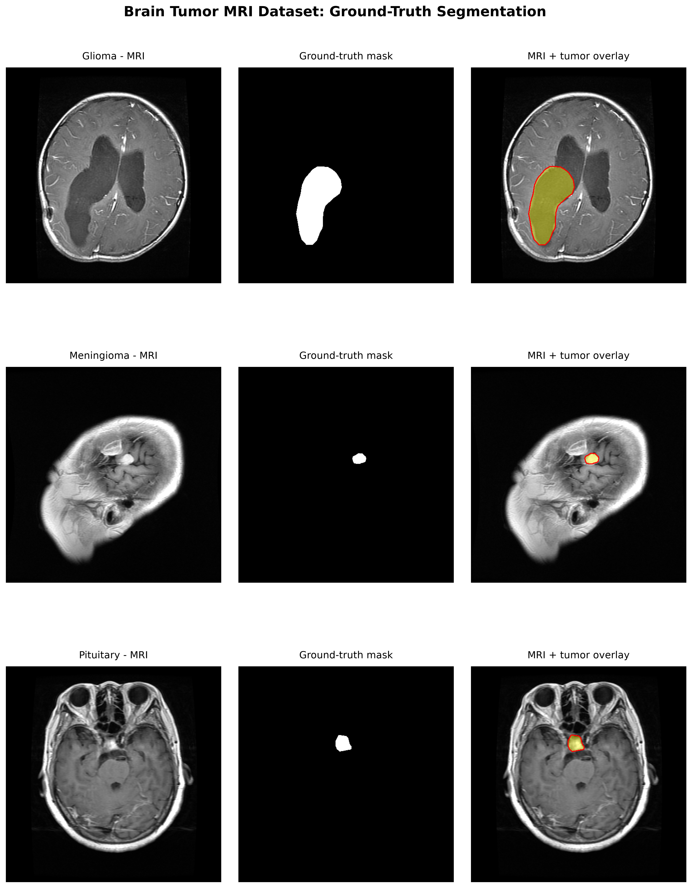
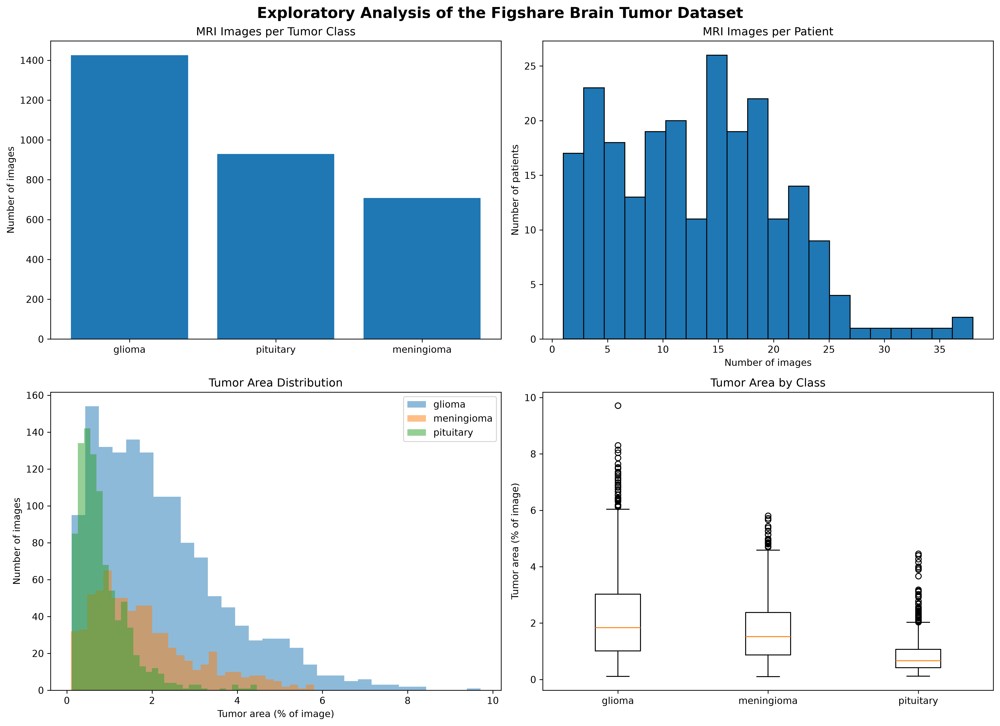
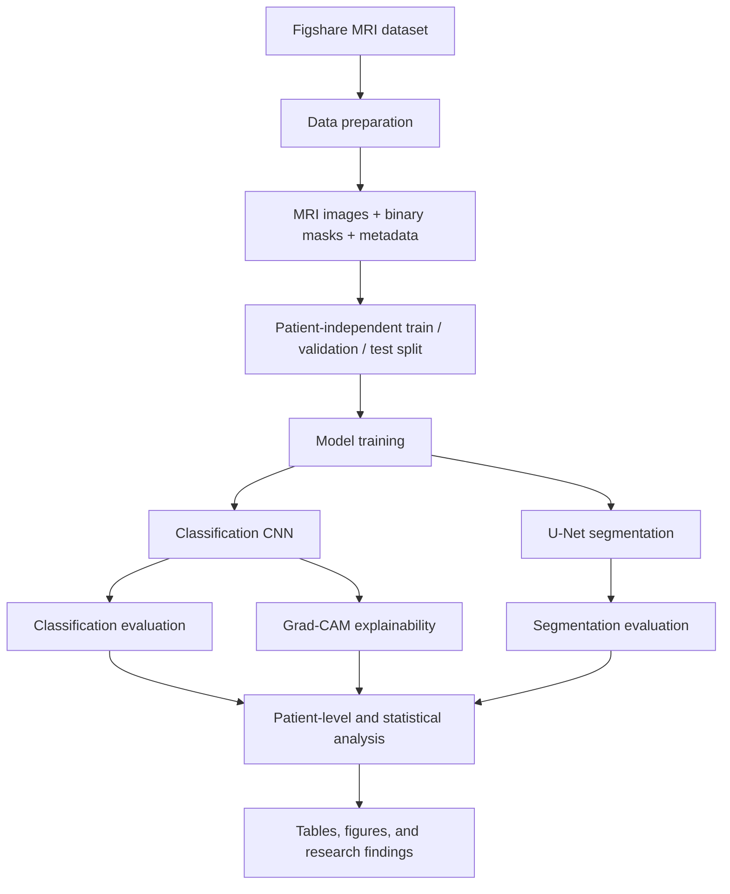
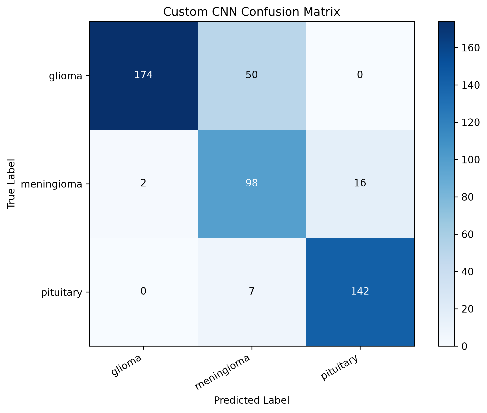
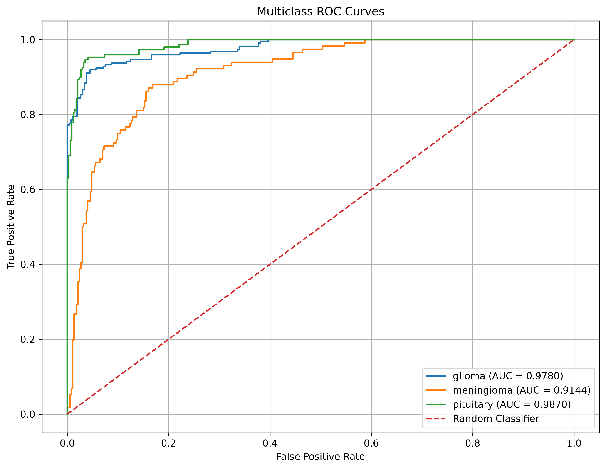
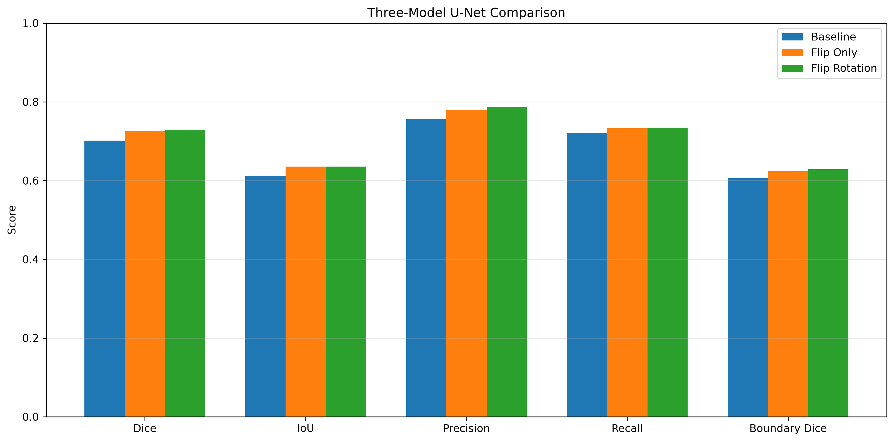
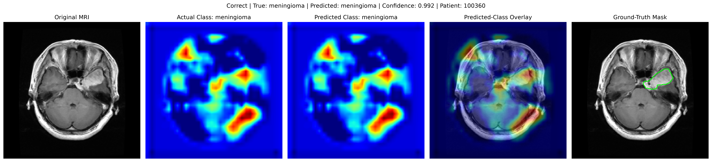
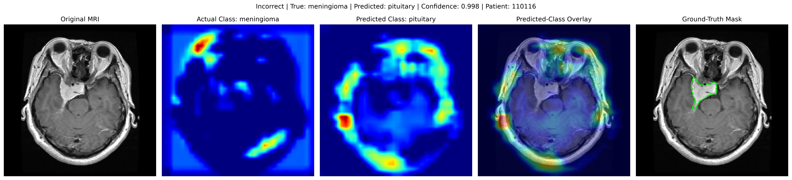

# Brain Tumor MRI Research
### Patient-independent classification · Tumor segmentation · Explainable deep learning

<p align="center">
  
</p>

<p align="center">
  <strong>A reproducible research pipeline for analyzing brain tumor MRI images with deep learning.</strong>
  <br>
  Built with Python, TensorFlow, Keras, NumPy, pandas, and scikit-learn.
</p>

---

## Overview

This repository contains an end-to-end research project focused on three complementary tasks using the Figshare brain tumor MRI dataset:

| Research task | Objective | Main approach |
|---|---|---|
| **Classification** | Predict the tumor category for an MRI slice | Convolutional neural networks |
| **Segmentation** | Delineate the tumor region at pixel level | U-Net and augmentation experiments |
| **Explainability** | Visualize image regions influencing classification predictions | Grad-CAM |

The three classification categories are **glioma**, **meningioma**, and **pituitary tumor**. The segmentation experiments use the dataset's manually annotated binary masks.

The project also includes patient-level evaluation, model comparisons, boundary-based segmentation metrics, statistical analysis, and failure-case inspection.

## Research Documentation

The complete technical and research documentation is maintained in the [Docs directory](Docs/README.md).

It contains 14 chapters covering the project methodology, dataset and preprocessing, exploratory analysis, classification and segmentation architectures, training experiments, evaluation metrics, patient-level and statistical analysis, Grad-CAM explainability, failure cases, results, reproducibility, and limitations.

**Recommended starting point:** [Read the documentation index](Docs/README.md).

## Dataset

**Source:** [Figshare — Brain Tumor Dataset](https://doi.org/10.6084/m9.figshare.1512427)

| Dataset characteristic | Description |
|---|---|
| MRI slices | 3,064 |
| Patients | 233 |
| Imaging modality | T1-weighted contrast-enhanced MRI |
| Classes | Glioma, meningioma, pituitary |
| Annotations | Image-level labels and binary tumor masks |

The original dataset is distributed under the **CC BY 4.0** license. Refer to the Figshare record for the original authorship, recommended citation, and license terms.

### Dataset exploration

<p align="center">
  
</p>

## Research pipeline

The workflow is organized into data preparation, patient-level partitioning, model training, and independent evaluation.



### Key methodological principles

- **Patient-independent partitions:** slices belonging to the same patient must remain in a single partition to reduce data leakage.
- **Training-only augmentation:** validation and test data are not augmented.
- **Validation-based model selection:** validation data are used for checkpoint selection and early stopping.
- **Independent test evaluation:** the test partition is reserved for final performance assessment, not model tuning.
- **Multiple evaluation levels:** image-level results are complemented by patient-level summaries.
- **Reproducibility:** seeds, preprocessing choices, model checkpoints, and evaluation outputs are recorded.

## Visual results

### Classification

<p align="center">
  
  
</p>

The classification evaluation scripts generate per-class metrics, confusion matrices, ROC curves, prediction tables, and patient-level analyses.

### Segmentation

<p align="center">
  
</p>

The segmentation experiments include:

- Baseline U-Net
- Augmented U-Net
- Flip-only U-Net

Evaluation includes Dice coefficient, Intersection over Union (IoU), precision, recall, patient-level summaries, and boundary-based measures such as HD95, ASSD, and Boundary Dice. Boundary distances are expressed in pixels at the model input resolution; they should not be interpreted as millimeters without valid image-spacing information.

### Research results snapshot

The following values are taken from the evaluation CSV files committed in this repository. They summarize the evaluated checkpoints and test partition represented by those files; they should not be interpreted as evidence of clinical readiness or external generalization.

| Task / experiment | Evaluation scope | Result |
|---|---|---:|
| Custom CNN classification | 489 test MRI slices | Accuracy: **0.8466** |
| Custom CNN classification | Macro one-vs-rest ROC-AUC | **0.9598** |
| Baseline U-Net | 489 test MRI slices | Mean Dice: **0.7016** |
| Flip-only U-Net | 489 test MRI slices | Mean Dice: **0.7259** |
| Flip + rotation U-Net | 489 test MRI slices | Mean Dice: **0.7281** |

For the paired patient-level comparison (35 patients), flip-only U-Net improved mean Dice over baseline by **0.0403** (95% bootstrap CI **[0.0103, 0.0761]**, Holm-adjusted *p* = **0.0019**). The flip + rotation comparison against baseline was not statistically significant after Holm correction (mean difference **0.0312**, 95% CI **[-0.0004, 0.0670]**, adjusted *p* = **0.3167**). The comparison between flip + rotation and flip-only was also not significant (mean difference **-0.0092**, 95% CI **[-0.0283, 0.0105]**, adjusted *p* = **0.4413**).

See [Chapter 09 — Statistical Analysis](Docs/09_statistical_analysis.md) and [Chapter 12 — Results and Discussion](Docs/12_results_and_discussion.md) for interpretation and analysis details.

### Explainability

Grad-CAM is used to visualize regions that contribute to classification predictions. Both correctly and incorrectly classified examples are retained for qualitative inspection.

<p align="center">
  
  
</p>

Grad-CAM maps are model explanations, not tumor segmentations or clinical evidence. Their overlap with manual masks is an analysis of localization behavior, not proof that the model has learned clinically valid features.

## Repository structure

```text
BrainTumorResearch/
├── Docs/                         # 14 chapters of technical and research documentation
│   ├── README.md
│   └── 01–14_*.md
├── data/
│   ├── raw/                       # Original dataset files (local)
│   └── processed/                 # Images, masks, splits.csv (local)
├── models/
│   ├── classification/            # Classification checkpoints
│   └── segmentation/               # U-Net checkpoints
├── results/
│   ├── classification/            # Classification metrics and plots
│   ├── explainability/             # Grad-CAM outputs
│   ├── figures/                    # Dataset visualizations
│   └── segmentation/              # Segmentation results and analyses
├── src/
│   ├── data/                       # Download, preparation, loading, EDA
│   ├── models/                     # CNN and U-Net architectures
│   ├── training/                   # Training pipelines
│   ├── evaluation/                 # Metrics, comparisons, statistics
│   └── explainability/             # Grad-CAM
├── .gitattributes
├── .gitignore
├── requirements.txt
└── README.md
```

The raw and processed dataset directories are local inputs and are not included in the repository. Model checkpoints are stored using Git LFS.

## Getting started

### 1. Clone the repository

```bash
git clone https://github.com/blerandd/BrainTumorResearch.git
cd BrainTumorResearch
```

### 2. Create and activate a virtual environment

**macOS / Linux**

```bash
python3 -m venv .venv
source .venv/bin/activate
```

**Windows PowerShell**

```powershell
py -3.11 -m venv .venv
.venv\Scripts\Activate.ps1
```

### 3. Install dependencies

```bash
python -m pip install --upgrade pip
pip install -r requirements.txt
```

Verify TensorFlow:

```bash
python -c "import tensorflow as tf; print(tf.__version__)"
```

TensorFlow installation and hardware acceleration vary by operating system and processor. Consult the official TensorFlow installation guide if installation requires platform-specific steps.

### 4. Retrieve Git LFS model files

Install [Git LFS](https://git-lfs.com/) before cloning if you want the stored model checkpoints:

```bash
git lfs install
git lfs pull
```

If you cloned before installing Git LFS, run the commands above from the repository directory.

### 5. Prepare the dataset

Download the original Figshare files and place the MATLAB files under `data/raw/`. Then run:

```bash
python -m src.data.prepare_dataset
```

Create the patient-independent partitions:

```bash
python -m src.data.make_splits
```

The data loader expects the following processed structure:

```text
data/processed/
├── images/
├── masks/
└── splits.csv
```

The `splits.csv` file must contain these columns:

```text
sample_id, patient_id, label, image_path, mask_path, split
```

Allowed split values are `train`, `validation`, and `test`. Image and mask paths are relative to `data/processed/`. The loader validates the metadata, checks that referenced files exist, and checks that a patient does not appear in multiple partitions.

### 6. Inspect the prepared data

```bash
python -m src.data.dataset_loader
python -m src.data.analyze_dataset
```

## Training

Run training commands from the repository root with the virtual environment activated and the dataset prepared.

| Experiment | Command |
|---|---|
| Classification CNN | `python -m src.training.train_classification` |
| Baseline U-Net | `python -m src.training.train_unet` |
| Augmented U-Net | `python -m src.training.train_unet_augmented` |
| Flip-only U-Net | `python -m src.training.train_unet_flip_only` |

Training scripts save model checkpoints under `models/` and training histories, logs, and plots under `results/`.

## Evaluation and analysis

### Main evaluation commands

```bash
python -m src.evaluation.evaluate_classification
python -m src.evaluation.evaluate_unet
python -m src.evaluation.evaluate_patient_level
python -m src.evaluation.evaluate_boundary_metrics
```

### Further analysis

The `src/evaluation/` directory contains additional scripts for:

- Comparing baseline, augmented, and flip-only segmentation experiments
- Comparing tumor-class performance
- Patient-level bootstrap confidence intervals and statistical comparisons
- Examining segmentation failure cases and missed tumors
- Investigating threshold sensitivity and empty predictions
- Exploring tumor morphology and MRI intensity relationships
- Visualizing model comparisons and patient-level changes

Run an individual analysis script from the repository root using:

```bash
python -m src.evaluation.<script_name>
```

Replace `<script_name>` with the Python filename without the `.py` extension.

## Explainability

Run Grad-CAM with:

```bash
python -m src.explainability.gradcam
```

Outputs are saved under `results/explainability/`.

## Models and implementation

| Component | Implementation |
|---|---|
| Deep learning framework | TensorFlow / Keras |
| Image processing | NumPy, Pillow, OpenCV |
| Data handling | pandas |
| Classification metrics | scikit-learn |
| Segmentation architecture | U-Net |
| Explainability | Grad-CAM |
| Visualization | Matplotlib |

The repository currently stores these model checkpoint paths through Git LFS:

- `models/classification/custom_cnn_best.keras`
- `models/segmentation/unet_best.keras`
- `models/segmentation/unet_augmented_best.keras`
- `models/segmentation/unet_flip_only_best.keras`

## Reproducibility and interpretation

For a fair evaluation, report both the number of MRI slices and the number of unique patients in each partition. Distinguish image-level metrics from patient-level metrics, and state how patient-level values are aggregated.

Segmentation overlap metrics measure agreement between predicted and reference masks. Boundary metrics provide complementary information about contour differences. Grad-CAM highlights features relevant to a classifier's output and must not be treated as a substitute for a segmentation mask.

Exploratory statistical relationships should be interpreted cautiously, especially when the number of independent patients is small. Report effect sizes, uncertainty, and the analysis scope alongside p-values; avoid causal claims from correlations.

## Limitations and responsible use

This repository is an academic research project. It is **not** a medical device or a clinical diagnostic system. Results on one dataset do not establish safety or generalization to other hospitals, scanners, patient populations, or MRI protocols. Model outputs must not be used as a substitute for assessment by qualified medical professionals.

## Dataset citation

Please cite the original dataset in reports and publications:

[Figshare — Brain Tumor Dataset](https://doi.org/10.6084/m9.figshare.1512427)

Consult the Figshare record for the full bibliographic citation and license details.
